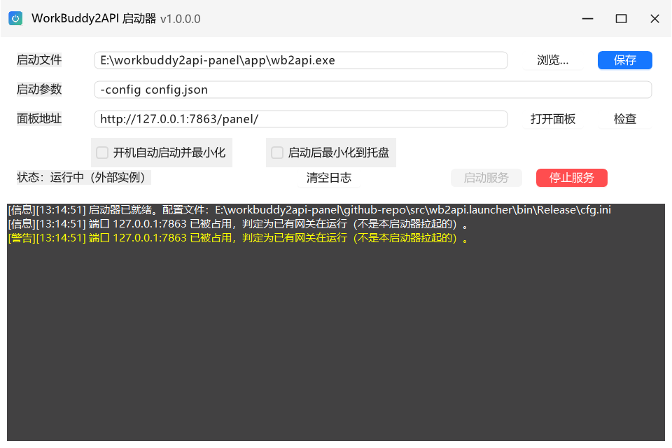
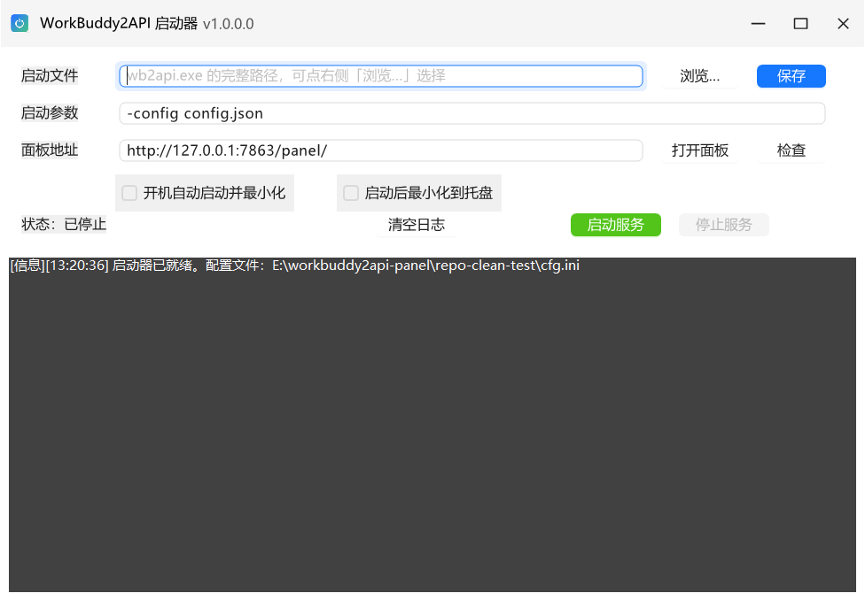
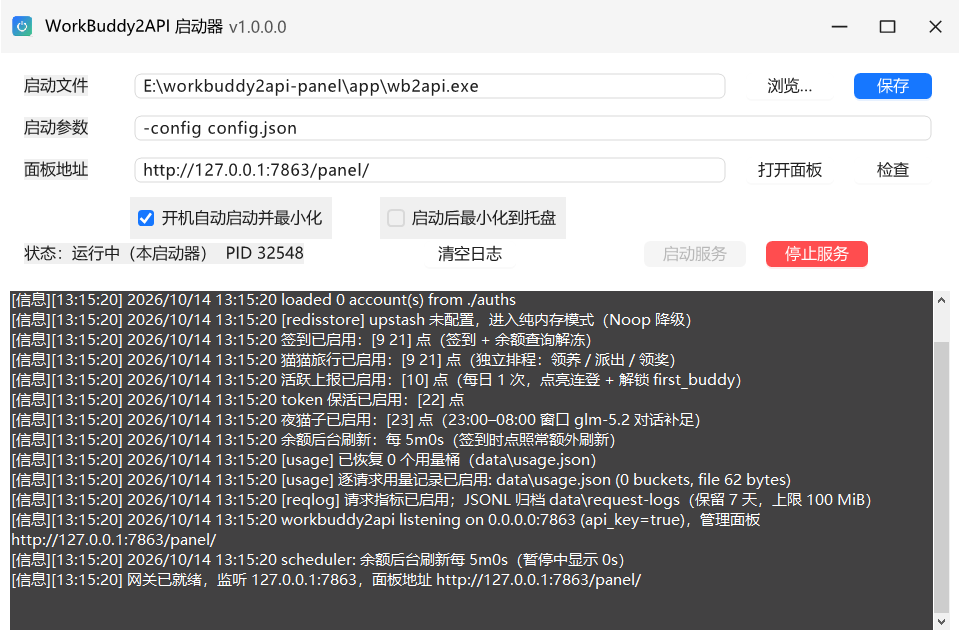

<p align="center">
  
</p>

# WorkBuddy2API Panel 托盘启动器

> 一个 Windows 小工具：双击图标就把 [workbuddy2api-panel](https://github.com/linguo2625469/workbuddy2api-panel) 网关**静默**拉起来，
> 启动成功弹托盘气泡通知，窗口自动收进系统托盘，全程**没有黑色控制台窗口**。

A tiny Windows tray launcher for the [workbuddy2api-panel](https://github.com/linguo2625469/workbuddy2api-panel) gateway:
silent start (no console window), balloon notification when the gateway is ready, close-to-tray, and a GUI to pick the
executable path when your install location changes. .NET Framework 4.8 / WinForms.



*上图：端口已被一个外部网关进程占用，所以状态行显示「运行中（外部实例）」，两个开关都是默认的关闭状态。*

---

## 目录

- [为什么做这个](#为什么做这个)
- [它做了什么](#它做了什么)
- [快速开始](#快速开始)
- [界面与操作](#界面与操作)
- [托盘行为](#托盘行为)
- [配置文件 cfg.ini](#配置文件-cfgini)
- [内置自检 --selftest](#内置自检---selftest)
- [从源码构建](#从源码构建)
- [关于 lib/new.framework.dll](#关于-libnewframeworkdll)
- [第三方组件与致谢](#第三方组件与致谢)
- [安全与合规提醒](#安全与合规提醒)
- [常见问题](#常见问题)
- [许可证](#许可证)

---

## 为什么做这个

上游项目自带的 `wb2api-panel-start.bat` 能用，但日常当"服务"来跑有三个别扭的地方：

| 痛点 | 现象 | 本启动器的做法 |
| --- | --- | --- |
| 黑窗 | 启动后留一个控制台窗口，关不掉，一关服务就没了 | 用 `CreateNoWindow` 直接拉起 `wb2api.exe`，并把它的 stdout/stderr 读进界面里的日志面板 |
| 路径写死 | bat 里写死了安装目录，换台机器/换个盘就得改文件 | 界面上填，或者点「浏览…」选 `wb2api.exe`，保存到 `cfg.ini` |
| 不知道起没起 | 只能盯窗口里的滚动日志 | TCP 探测端口就绪后弹托盘气泡「网关服务已启动，面板地址 …」，界面状态行同步显示 PID |

另外补了两个日常需求：**开机自启**（写当前用户的 `Run` 键，带 `--minimized`）和**关窗口不等于停服务**（关闭=收进托盘）。

## 它做了什么

- **静默启动**：`ProcessStartInfo.CreateNoWindow = true` + `UseShellExecute = false`，子进程没有可见窗口，也没有任务栏按钮
- **就绪探测**：从「面板地址」解析出主机与端口，25 秒内每 300ms 做一次 TCP 连接探测（`GatewayRunner.cs`）
- **启动通知**：就绪后托盘气泡提示面板地址；失败则气泡提示失败原因
- **日志回流**：网关的 stdout/stderr 逐行显示在界面下方的日志控制台（带时间戳），可一键清空
- **停止服务**：只结束**自己拉起**的进程树（`taskkill /F /T /PID`），检测到"外部实例"（端口已被别的进程占用）时不会乱杀
- **状态自检**：「检查」按钮访问 `/healthz` 并把结果打进日志
- **关闭收进托盘**：点右上角 × 只是隐藏窗口，服务继续跑；托盘菜单「退出启动器」才会问你是否一并停掉网关
- **单实例**：再次双击图标不会多开，而是把已经隐藏的那个实例的窗口唤到前台
- **开机自启**：可选开关，写 `HKCU\Software\Microsoft\Windows\CurrentVersion\Run`，卸载只需取消勾选

## 快速开始

### 我是使用者



1. 先把 workbuddy2api-panel 网关装好（本仓库**不含**网关本体，只含启动器）。
2. 解压启动器到任意目录，保证同一层有：
   `wb2api.launcher.exe`、`wb2api.launcher.exe.config`、`cfg.ini`、`new.framework.dll` 以及 `AntdUI.dll` 等依赖 DLL。
3. 双击 `wb2api.launcher.exe`。第一次因为没有配置路径，只会打开界面并提示选择：在「启动文件」点「浏览…」选中
   `wb2api.exe` → 点「保存」。之后每次双击图标都会自动把网关拉起来。
4. 看到气泡「网关服务已启动，面板地址 http://127.0.0.1:7863/panel/」即成功。之后可以放心点 ×，服务继续跑。
5. 想开机就自动跑：勾选「开机自动启动并最小化」，保存即可（会写当前用户的注册表 `Run` 键）。

> 想放到桌面：右键 `wb2api.launcher.exe` → 发送到 → 桌面快捷方式。给快捷方式加「启动时最小化」不是必需的，
> 本程序自己处理最小化与托盘。

### 我是开发者

用 Visual Studio 2017 及以上打开 `wb2api.launcher.sln`，直接生成 Release。详见 [从源码构建](#从源码构建)。

## 界面与操作



| 控件 | 作用 |
| --- | --- |
| 启动文件 | `wb2api.exe` 的完整路径。安装位置变了只改这里 |
| 浏览… | 在文件对话框里重选 exe，选完自动回填路径 |
| 启动参数 | 传给网关的参数，默认 `-config config.json`（相对 exe 所在目录） |
| 面板地址 | 管理面板 URL，默认 `http://127.0.0.1:7863/panel/`。**就绪探测用的主机和端口就是从它解析出来的** |
| 打开面板 | 用默认浏览器打开上面的地址 |
| 检查 | 请求 `http://<host>:<port>/healthz`，结果写进日志 |
| 开机自动启动并最小化 | 写/删当前用户 `Run` 键；勾选后开机即以 `--minimized` 静默运行 |
| 启动后最小化到托盘 | 手动双击打开时也立刻收进托盘。**默认关闭**——双击图标必须看得见界面 |
| 状态行 | `已停止` / `启动中` / `运行中（本启动器 PID n）` / `运行中（外部实例）` / `启动失败` |
| 启动服务 / 停止服务 | 手动控制；「停止服务」只停本启动器拉起的进程 |
| 清空日志 | 清掉下方日志控制台 |
| 日志控制台 | 网关的 stdout/stderr 与启动器自己的提示 |

以上每一项操作都会在日志控制台留一行中文提示，出错时气泡也会同步提示。

## 托盘行为

- 托盘图标 = 主程序图标；**双击托盘图标**或**再次双击 exe**：唤出主界面
- **右键托盘图标**：显示主界面 / 启动服务 / 停止服务 / 打开管理面板 / 检查网关状态 / 退出启动器
- 点窗口 × ：窗口隐藏，服务继续运行，并弹一次「已最小化到托盘」气泡
- 选「退出启动器」：若网关已就绪，会先问「退出前是否一并停止网关服务？」，选"否"则服务继续在后台跑

隐藏与还原都走 Win32 `ShowWindow` / `SetWindowPos`，**不会重建窗口句柄**——这是踩过坑的：托管的
`Hide()` / `Show()` / 改 `ShowInTaskbar` 会让窗口还原到屏幕外的 `(-32000,-32000)`，表现为"双击图标没反应"。
还原位置还会被 `ResolveVisibleBounds` 校正到主屏工作区内。

## 配置文件 cfg.ini

编码 **GBK**、换行 CRLF，与 exe 同目录（框架的 `my.common.Config` 读写）。

```ini
[Launcher]
ExePath=E:\workbuddy2api-panel\app\wb2api.exe
Arguments=-config config.json
PanelUrl=http://127.0.0.1:7863/panel/
AutoRunOnStart=N
AutoMinimize=N
```

| 键 | 含义 | 默认 |
| --- | --- | --- |
| `ExePath` | `wb2api.exe` 绝对路径。**只要它有效，程序一打开就会拉起网关**（双击图标 = 启动服务，这是设计意图） | 空（空则只开界面并提示选路径） |
| `Arguments` | 启动参数，相对 exe 所在目录解析 | `-config config.json` |
| `PanelUrl` | 面板地址，决定探测与 `/healthz` 用的主机/端口 | `http://127.0.0.1:7863/panel/` |
| `AutoRunOnStart` | 界面勾选「开机自动启动并最小化」的状态镜像；真正的开关是注册表 `Run` 键本身 | `N` |
| `AutoMinimize` | 启动后立刻收进托盘（`--minimized` 命令行参数有同样效果） | `N` |

取值接受 `Y/N`、`T/F`、`1/0`、`TRUE/FALSE`。

**`AutoRunOnStart` / `AutoMinimize` 的默认值都是关**，这是刻意的：改注册表、开机自启、"双击图标却看不见窗口"都属于
"不该在用户没要求时静默发生"的动作。

## 内置自检 --selftest

```bat
wb2api.launcher.exe --selftest
type selftest.log
```

不弹界面、不启动网关，跑 **67 条断言**并写 `selftest.log`（GBK），全部通过时退出码 0。覆盖：

- 配置读写往返（含 `Y/N` 各种写法、缺省值、乱值不崩）
- 面板地址解析主机/端口
- 网关状态机文案
- 托盘还原位置计算（含"保存在屏外"的纠正）
- 开机自启注册表读写（**真实写 `HKCU\...\Run` 并在结束后还原**）
- 端口无人监听时健康检查正确报错

CI 里可以直接 `wb2api.launcher.exe --selftest && type selftest.log`。
注意它是 `WinExe`：在 Git Bash / MSYS 下调用要用 `cmd //c "wb2api.launcher.exe --selftest"`，否则 shell 不等它退出，会看到"假通过"。

## 从源码构建

环境：Windows 10/11 + .NET Framework 4.8（含 Targeting Pack）+ Visual Studio 2017+ 或 MSBuild 15+。

```bat
msbuild wb2api.launcher.sln /t:Rebuild /p:Configuration=Release
```

产物在 `src\wb2api.launcher\bin\Release\`：

```
wb2api.launcher.exe        主程序
wb2api.launcher.exe.config 依赖版本重定向（System.Memory / System.Buffers），必须和 exe 一起发
cfg.ini                    空配置文件（首次运行后由程序写入）
new.framework.dll          框架合并产物，见下一节
AntdUI.dll 等              第三方依赖，全部来自仓库的 lib\ 目录
```

仓库结构：

```
wb2api.launcher.sln
lib/                     二进制依赖（框架合并产物 + 第三方 DLL）
src/wb2api.launcher/     启动器源码（业务代码只有 12 个 .cs）
  Program.cs             入口：单实例判定 + 框架启动
  SelfTest.cs            --selftest 的 67 条断言
  Services/              配置、网关进程管理、开机自启、单实例唤起
  UI/                    MainForm（外壳 + 托盘 + Win32 显隐）、BodyForm（界面与日志）
docs/                    截图与图标
```

## 关于 lib/new.framework.dll

本项目的 UI 与工具类构建在作者自研的私有框架 **6.new.framework**（.NET Framework 4.8 + WinForms + AntdUI）上，
该框架**不开源**。为了让这个仓库既能独立编译、又不泄露框架源码，`lib\new.framework.dll` 是这样产出的：

1. **合并**：用 ILMerge 把 `my.common`、`my.antd.ui`、`my.antd.common`、`my.auth`、`my.download` 五个程序集
   合并成单个 `new.framework.dll`（保持原强名称公钥令牌）。
2. **混淆**：用 SmartAssembly 8 做控制流混淆、字符串加密、资源压缩、MemberRefsProxy，并开启 `SuppressIldasm`
   （成品用 ildasm 打开会直接提示"受保护的程序集"）。
3. **保留公开 API**：混淆前先用反射导出该程序集的全部 **228 个 public 类型**，逐个写成 SmartAssembly 的
   `WholeType` 排除规则。因此 **public 类型与成员名一律不改名**，私有实现照常被改名。

这样做的结果是：

- 本仓库的源码可以像引用普通类库一样引用它，`msbuild` 一条命令就能编译，二次开发无障碍；
- 仓库里没有任何框架源码；
- 它是**二进制依赖**，不参与本仓库源码的编译过程（改业务代码不需要重编它）。

如果你要把这层依赖去掉：把 `UI\MainForm.cs` / `UI\BodyForm.cs` 改成继承原生 `Form`，并自行实现
`my.common.App` / `Config` / `Dialog` / `Toast` 的等价物即可，其余业务代码（`Services\`）不依赖框架。

> 顺带一提：`App.config` 里的 `System.Memory` / `System.Buffers` 绑定重定向是必须的——混淆后的框架程序集
> 仍会引用这两个 BCL 兼容包，缺重定向会在运行时报版本冲突。

## 第三方组件与致谢

- **[AntdUI](https://github.com/AntdUI/AntdUI)**（Apache License 2.0）—— 本项目全部界面控件（`Input`、`Button`、`Checkbox`、
  `Label`、`Table` 等）与主题、DPI 适配都来自 AntdUI。一个"自己用的小启动器"能长这样，基本都是它的功劳，
  **在此特别感谢 AntdUI 的开源授权（Apache-2.0）**，让个人项目可以零成本用上质量很高的 Ant Design 风格控件。
  `lib\AntdUI.dll` 与 `lib\AntdUI.EmojiFluentFlat.dll` 均以未修改的原始形式分发。
  同时也感谢 [AntdUI.EmojiFluentFlat](https://github.com/AntdUI/AntdUI) 提供的表情资源。
- 其余随二进制依赖一起分发的第三方库（log4net、Newtonsoft.Json、BouncyCastle.Crypto、HtmlAgilityPack、
  ICSharpCode.SharpZipLib、Downloader、EventSource4Net、.NET 的 `System.*` 兼容包）的许可证与出处，
  见 [THIRD-PARTY-NOTICES.md](THIRD-PARTY-NOTICES.md)。
- 图标由 AI 生成（ImageGen），转成多尺寸 ICO 后作为程序图标与托盘图标。

本项目与上游 workbuddy2api-panel 项目没有隶属关系，只是它的一个外部启动器。

## 安全与合规提醒

- 网关的 `auths\` 目录里是**明文的 accessToken / refreshToken**。请把它当成密码看待：
  不要提交进 git（本仓库 `.gitignore` 已经排除 `auths/`、`data/`、`config.json`、`*.api_key`），不要发到群里。
- 网关默认监听 `0.0.0.0:7863`，即**同一局域网内其他机器都能访问面板**。不需要就把它改回 `127.0.0.1`，
  更不要把它直接暴露到公网。
- 本启动器不会读取、上传或改写你的账号凭据，它只负责拉起进程、探测端口、显示日志。
- 上游项目对其账号池的使用有明确限制（不得转卖、不得用于批量注册、不得加壳售卖）。使用本启动器不改变这些约束。

## 常见问题

**双击图标没反应 / 看不到窗口？**
先看任务管理器里有没有 `wb2api.launcher.exe`。有进程但没窗口，通常是上一次被收进了托盘：再双击一次图标即可唤出，
或看托盘（可能被折叠在"隐藏的图标"里）。本仓库当前版本已修掉"窗口还原到屏幕外"的问题（见[托盘行为](#托盘行为)）。

**状态显示"运行中（外部实例）"？**
端口已被别的进程监听（例如你还开着上游的 `wb2api-panel-start.bat`，或另一个启动器实例）。这是正常提示，
此时「停止服务」不会动那个进程，请去原来的窗口停止它。

**气泡提示启动失败，或者 25 秒超时？**
九成是路径不对：确认「启动文件」指向真实的 `wb2api.exe`，且它的**同目录**有 `config.json`
（默认参数 `-config config.json` 是相对 exe 目录解析的）。改完点「保存」再点「启动服务」。

**`/healthz` 返回 503、`total:0`？**
不是启动器的问题——网关还没在面板里上传任何 CodeBuddy 账号。打开面板加账号即可。

**怎么取消开机自启？**
把「开机自动启动并最小化」的勾去掉（会立即删除注册表 `Run` 项），或手动删除
`HKCU\Software\Microsoft\Windows\CurrentVersion\Run` 下的 `WB2ApiLauncher` 值。

**日志里中文乱码？**
`cfg.ini` 与 `selftest.log` 都是 GBK 编码，用记事本/VS Code（选 GB2312）打开即可。

## 许可证

[MIT](LICENSE) © 2026 The wb2api-launcher authors

本仓库的启动器源码按 MIT 许可提供。`lib\new.framework.dll` 是作者自研框架的合并混淆产物，
以二进制形式随仓库免费提供、可随本项目一起分发使用，但**不含源码**；第三方组件遵循各自的许可证
（见 [THIRD-PARTY-NOTICES.md](THIRD-PARTY-NOTICES.md)）。
